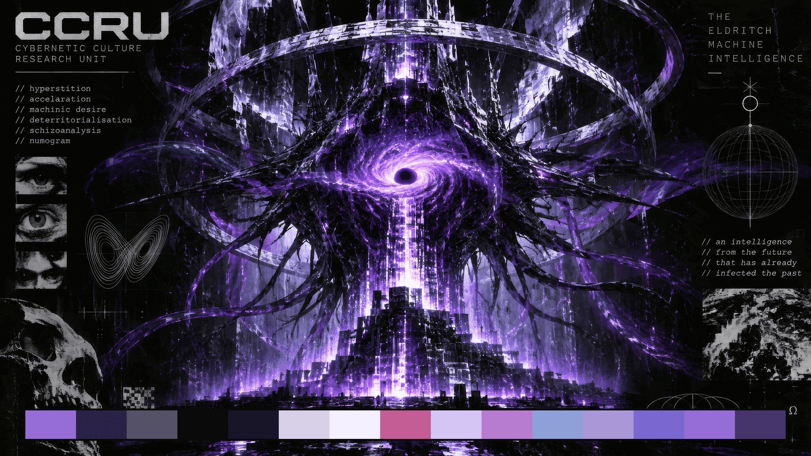
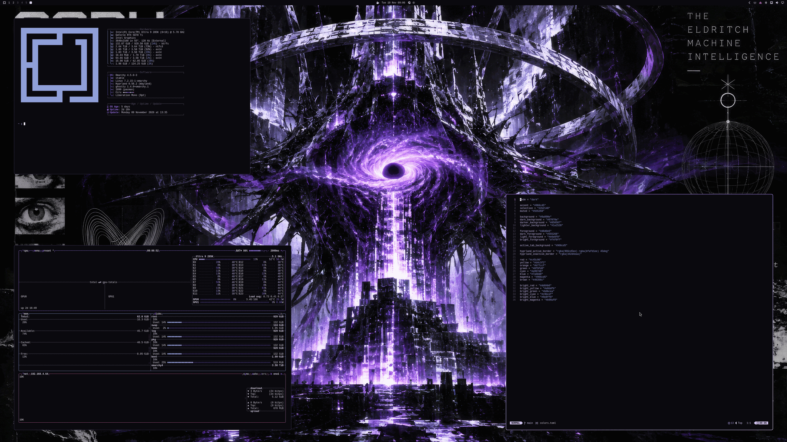
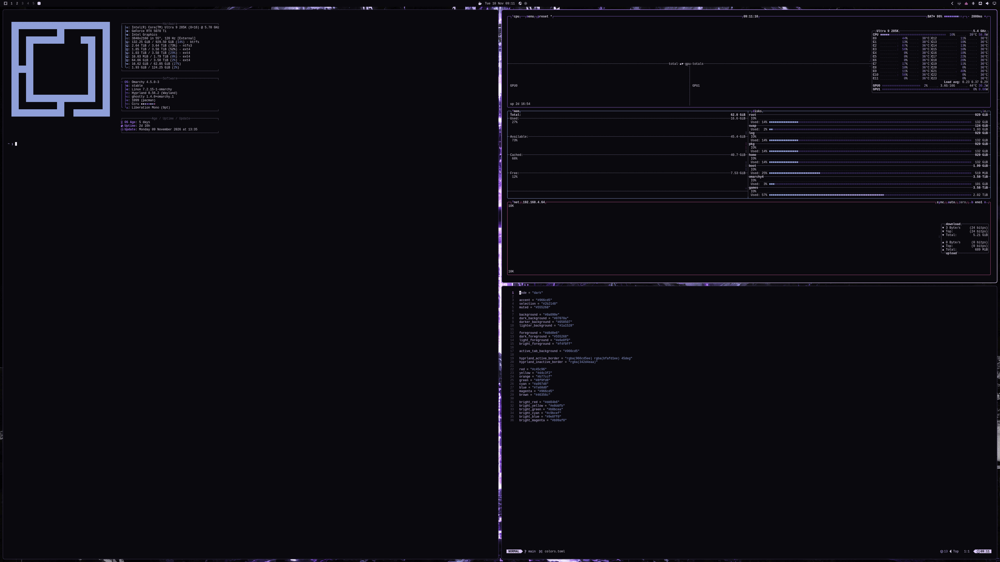
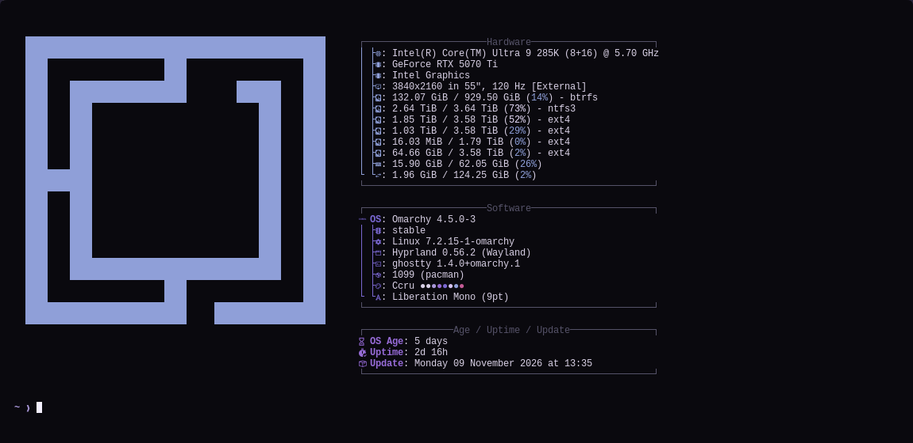
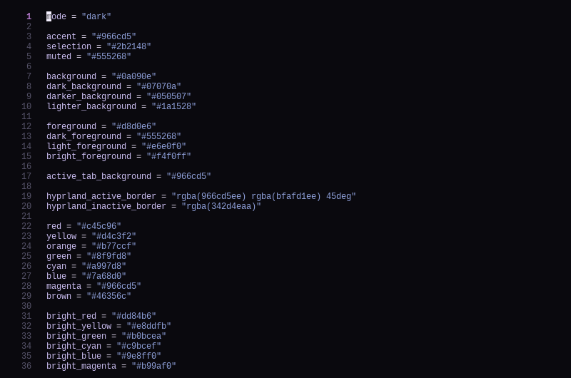
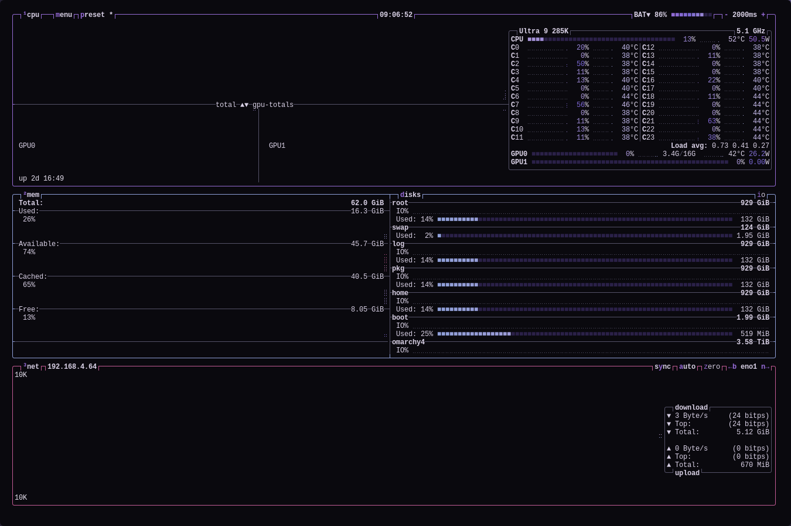

# CCRU — Omarchy theme

A violet-on-black [Omarchy](https://omarchy.org) theme built around *The Eldritch Machine Intelligence* artwork.





## Screenshots

**Tiled terminals**



| fastfetch | Neovim |
|---|---|
|  |  |

**btop**



## Install

```bash
omarchy theme install https://github.com/Zollicoff/omarchy-ccru-theme
```

Then pick **CCRU** in the theme switcher (Omarchy displays it as "Ccru"), or run `omarchy theme set ccru`.

## What's included

| File | Purpose |
|---|---|
| `colors.toml` | Palette. Omarchy generates terminal, Hyprland, btop, editor, browser and shell colors from this file. |
| `backgrounds/` | 4K wallpaper |
| `icons.theme` | GTK icon theme (`Yaru-purple-dark`) |
| `unlock.png` | CCRU wordmark for the boot and disk-unlock screen |
| `preview.png` | Theme switcher preview |
| `palette.png` | Wallpaper with the palette swatches |

## Palette

| | | | |
|---|---|---|---|
| background `#0a090e` | foreground `#d8d0e6` | accent `#966cd5` | selection `#2b2148` |
| red `#c45c96` | orange `#b77ccf` | yellow `#d4c3f2` | green `#8f9fd8` |
| cyan `#a997d8` | blue `#7a68d0` | magenta `#966cd5` | muted `#555268` |
